# Ru-Beacon

> **마인크래프트 서버와 디스코드 커뮤니티를 실시간 연동하는 이벤트 구동 워크플로우 엔진**

[](https://github.com/mmmphyun/ru-beacon/actions/workflows/ci.yml)
[](https://github.com/mmmphyun/ru-beacon/actions/workflows/cd.yml)
[](https://kotlinlang.org)
[](https://openjdk.org)
[](https://nextjs.org)
[](https://k3s.io)
[](LICENSE)

---

## 1. 프로젝트 개요

Ru-Beacon은 마인크래프트 게임 서버의 인게임 이벤트(출석, 도전과제 달성, 상점 구매 등)를 비동기로 수집해 디스코드 알림과 웹 대시보드로 전달하고, 역으로 디스코드나 웹에서 인게임 명령을 실행하는 분산 이벤트 엔진이다.

1인 개발 환경에서 클라우드 비용을 0원으로 통제하면서도 대규모 동시 접속 상황을 안정적으로 처리하고자 저비용 인프라 최적화와 2단계 진입 제어 아키텍처를 적용했다.

- 배포 환경: 오라클 클라우드 Always Free 2노드 K3s 분산 클러스터
- 공개 API 규격: http://api.<NODE_IP>.sslip.io (WSS / REST)
- 웹 대시보드 규격: http://dashboard.<NODE_IP>.sslip.io
- 버전: v0.1.0-alpha.1

<picture>
  <source media="(prefers-color-scheme: dark)" srcset="docs/rubeacon-architecture-dark.svg">
  
</picture>

---

## 2. 분산 클러스터 인프라 구성

월 비용 지출 없이 상시 가동하기 위해 오라클 클라우드 Always Free의 ARM64(Ampere A1) 자원을 2개 가상 머신으로 분할하여 경량 쿠버네티스 K3s 클러스터를 구축했다.

- 노드 1 (컨트롤 플레인): 2 코어, 12GB 메모리, 우분투 24.04 ARM64
  - 역할: K3s API 서버, Traefik 인그레스 컨트롤러, 코어 API 서비스, 웹 대시보드
  - 데이터 저장소: PostgreSQL 16, Redis 7 (로컬 패스 스토리지 데이터 유실 방지를 위해 노드 고정 배치)
- 노드 2 (워커): 2 코어, 12GB 메모리, 우분투 24.04 ARM64
  - 역할: 워크플로우 워커 2대, 디스코드 봇 서비스
- 내부 네트워크: Flannel 오버레이 네트워크(사설 가상망 대역 10.0.0.0/16)를 통해 노드 간 파드 통신 수행

---

## 3. 핵심 아키텍처 및 엔지니어링 의사결정

### 1) 2단계 진입 제어를 통한 데이터베이스 커넥션 고갈 차단
- 문제: 특정 시점에 수천 명의 플레이어가 동시에 보상 수령을 시도할 때, 모든 요청이 관계형 데이터베이스로 직격하면 단일 행 락 경합과 HikariCP 커넥션 풀(최대 10개) 고갈로 전체 API 서버가 다운됨.
- 해결:
  - 1차 관문: Redis Lua 스크립트를 통해 인메모리에서 정원 초과 여부와 중복 수령 여부를 O(1) 원자 연산으로 검증. 초과 요청은 데이터베이스 질의 없이 3ms 이내에 즉시 차단하여 HTTP 429나 409를 반환.
  - 2차 관문: 1차 관문을 통과한 선착순 정원 요청만 PostgreSQL 트랜잭션으로 넘겨 영속화 수행.
  - 보상 롤백: 2차 데이터베이스 쓰기 실패 시 Redis 선점 수량을 즉시 원복하여 상태 불일치 차단.

### 2) 게임 서버 틱 무영향 원칙
- 마인크래프트 서버 엔진은 1초에 20틱(1틱당 50ms) 주기로 월드를 계산하므로 메인 스레드가 블로킹되면 인게임 렉이 발생함.
- 플러그인 내부의 웹소켓 통신과 하트비트 전송을 전용 코루틴 비동기 입출력 스코프로 완전 격리하여 메인 틱 간섭 0ms를 보장함.
- 인바운드 원격 실행 명령은 버킷 스케줄러를 통해 메인 스레드로 안전하게 브릿징하여 비동기 스레드 접근 크래시를 원천 차단함.

### 3) 큐 적체 기반 KEDA 자동 증설
- 코루틴 기반 워커는 논블로킹 I/O 특성상 이벤트 큐에 수만 건이 쌓여도 CPU 점유율이 30%를 넘지 않음.
- 표준 CPU 기반 오토스케일링의 한계를 극복하기 위해 KEDA를 도입하여 Redis Streams 컨슈머 랙을 직접 감지하고, 이벤트 적체 발생 시 워커 파드를 기본 2대에서 최대 6대까지 동적 증설하도록 구성함.

---

## 4. 1,000 RPS 분산 동시성 부하 테스트 실측 비교

로컬 k3d 루프백 환경과 실제 공용 클라우드 분산 환경(오라클 클라우드 2노드 K3s) 간의 네트워크 지연 및 처리 성능을 동일한 k6 부하 프로파일(1,000 RPS 피크 버스트 65초)로 실측 비교했다.

| 지표 항목 | 로컬 k3d 가상화 | 오라클 클라우드 2노드 (실제 분산망) | 공학적 분석 |
| :--- | :---: | :---: | :--- |
| 총 요청 수 | 39,249건 | 39,084건 (실패 0.00%) | 공용 인터넷 환경에서 패킷 유실 0건으로 1,000 RPS 수용 |
| 1차 관문 차단율 | 99.36% (38,999건) | 96.05% (37,544건 차단 / 1,540건 확정) | 분산 Redis 인메모리 관문 차단 일관성 검증 |
| 서버 내부 연산 지연 (TTFB) | 평균 1.17ms / P95 2.00ms | 평균 1.84ms / P95 3.02ms | 물리 네트워크 거리를 제외한 순수 연산은 3ms 이내 유지 |
| 클라이언트 체감 P95 지연시간 | 2.07ms (루프백) | 42.88ms (한국-오사카 공용망) | 한국-오사카 해저 광케이블 물리 왕복 지연 약 35ms 포함 |
| 클라이언트 체감 P99 지연시간 | 3.16ms (루프백) | 53.94ms (한국-오사카 공용망) | 인터넷 라우팅 지터 환경에서도 55ms 이내 안정 응답 유지 |
| 데이터베이스 풀 상태 | 최대 10개 유지 (고갈 0) | 최대 10개 유지 (고갈 0) | 1,000 RPS 동시 유입 상황에서도 커넥션 고갈 0건 방어 |
| 초과 발급 수량 | 0건 | 0건 | 고경합 분산 환경에서 정원 초과 지급 0건 무결성 입증 |

---

## 5. 비용 통제 및 인프라 보안 엔지니어링

- 클라우드 과금 0원 통제: 오라클 클라우드 Quota 정책을 테라폼 코드로 선언하여 ARM A1 코어 4개, 메모리 24GB, 블록 스토리지 200GB 초과 생성을 하드 리밋으로 차단함. 추가로 1달러 도달 시 즉시 알림이 발송되는 예산 감시 룰을 설정함.
- 상태 저장 스토리지 고립 방어: K3s 기본 로컬 패스 스토리지는 노드 간 볼륨 이동이 불가능하므로, 데이터베이스 파드가 워커 노드로 잘못 스케줄링되어 스토리지를 잃어버리는 결함을 방지하기 위해 노드 선택자를 사용하여 컨트롤 플레인 노드에 스토리지를 고정함.
- 멀티아키텍처 배포 자동화: x86_64 기반 깃허브 러너에서 QEMU 에뮬레이터를 연동하여 linux/amd64와 linux/arm64 듀얼 아키텍처 컨테이너 이미지를 자동 빌드하고 깃허브 패키지 레지스트리에 푸시하는 배포 파이프라인을 구축함.

---

## 6. 공식 기술 문서 목록

프로젝트 아키텍처와 엔지니어링 의사결정 내역은 [`docs/`](docs/) 디렉토리에 전수 기록되어 있습니다.

- [ALPHA_DEPLOYMENT_PLAN.md](docs/ALPHA_DEPLOYMENT_PLAN.md): OCI Always Free 2-Node 배포 및 라이브 쇼케이스 공식 로드맵
- [DECISION_LOG.md](docs/DECISION_LOG.md): 10대 아키텍처 의사결정(ADR DEC-066-078) 원천 기록
- [ENGINEERING_LOG.md](docs/ENGINEERING_LOG.md): 마일스톤 0-7 아키텍처 트레이드오프 및 10대 결함 리팩터링 기록
- [BENCHMARK_REPORT.md](deploy/load-test/BENCHMARK_REPORT.md): k6 1,000 RPS 분산 동시성 벤치마크 상세 리포트
- [DATABASE_SCHEMA.sql](docs/DATABASE_SCHEMA.sql): PostgreSQL 16 Flyway V1 공식 DDL 명세
- [TRANSPORT_PROTOCOL_SPEC.md](docs/TRANSPORT_PROTOCOL_SPEC.md): WSS 인바운드/아웃바운드 프레임 규격 및 Redis Streams 네임스페이스
- [WORKFLOW_ENGINE_SPEC.md](docs/WORKFLOW_ENGINE_SPEC.md): 워크플로우 DAG AST 파서, Tarjan 사이클 감지 엔진 명세

---

## 7. 로컬 빌드 및 빠른 시작

### 요구사항
- **JDK 21** (Eclipse Temurin 권장)
- **Node.js 20+** 및 **pnpm 12+**
- **Docker Desktop** (통합 테스트 시 Testcontainers 실행용)

### 백엔드 전체 멀티모듈 빌드 및 테스트
```powershell
# 백엔드 멀티모듈 전수 테스트 실행 (Testcontainers 자동 기동)
.\gradlew.bat test

# 특정 모듈 빌드 산출물 생성 (installDist)
.\gradlew.bat :api-service:installDist
.\gradlew.bat :workflow-worker:installDist
```

### 프론트엔드 대시보드 빌드 및 테스트
```powershell
cd web-dashboard
pnpm test
pnpm lint
pnpm build
```

---

## 8. 라이선스

이 프로젝트는 **GNU Affero General Public License v3.0 ([AGPL-3.0](LICENSE))** 하에 배포됩니다.
SaaS 형태로 서비스를 운영·배포할 경우에도 수정된 전체 소스코드를 공개해야 하며, 무단 상업적 재판매 및 폐쇄 소스화가 엄격히 제한됩니다.
